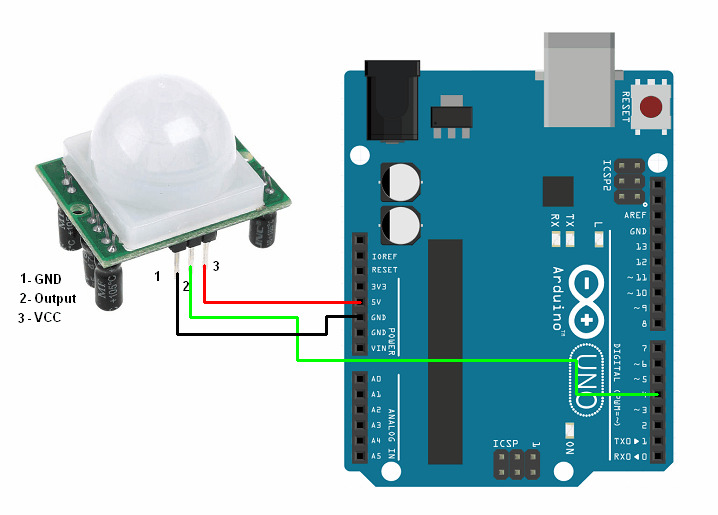

# Motion Sensor Detector


A simple and reliable DIY motion detection system built using an **Arduino Uno** and a **PIR (Passive Infrared) Motion Sensor**. It detects human or animal movement in real time and outputs status signals via the Serial Monitor (or optional LEDs/buzzers).

---

## Circuit Diagram & Demo


---

## Features
* **Real-Time Motion Detection:** Uses a Passive Infrared (PIR) sensor to detect infrared radiation changes caused by movement.
* **Plug-and-Play Wiring:** Requires only 3 jumper wires between the PIR sensor and Arduino Uno.
* **Serial Monitoring:** Prints real-time motion status (`Motion Detected` / `No Motion`) to the Arduino Serial Monitor.
* **Expandable Design:** Easily connect an LED, buzzer, relay, or Wi-Fi module (ESP8266/ESP32) for automated lighting or security alerts.

---

## System Architecture

```text
[PIR Motion Sensor (HC-SR501)] ---> [Arduino Uno (Digital Pin 4)] ---> [Serial Monitor / Output Alert]
```

---

## Hardware Requirements
| Component | Specification / Model | Quantity |
| :--- | :--- | :---: |
| Microcontroller | Arduino Uno (R3) | 1 |
| Motion Sensor | PIR Motion Sensor (HC-SR501) | 1 |
| Jumper Wires | Male-to-Female | 3 |
| Power / Data Cable | USB Type-A to Type-B Cable | 1 |

---

## Pinout / Wiring
| PIR Sensor Pin | Arduino Uno Pin | Wire Color | Function |
| :--- | :--- | :--- | :--- |
| `1 - GND` | `GND` | Black | Ground |
| `2 - Output` | `Digital Pin 4` | Green | Digital Signal Input |
| `3 - VCC` | `5V` | Red | Power Supply |

---

## Quick Start

### 1. Prerequisites
* **IDE:** [Arduino IDE](https://www.arduino.cc/en/software)
* **Libraries:** No external libraries required (uses built-in Arduino functions).

### 2. Setup & Wiring
1. Clone this repository:
   ```bash
   git clone https://github.com/Shanmugash24/IOT_DIY-project.git
   ```
2. Wire the PIR sensor to the Arduino Uno following the **Pinout / Wiring** table and diagram above.

### 3. Flash & Run
1. Open the `.ino` sketch in the Arduino IDE.
2. Connect the Arduino Uno to your PC via USB.
3. Go to **Tools > Board** and select **Arduino Uno**, then select the correct **Port**.
4. Click **Upload**.
5. Open the **Serial Monitor** (`Ctrl + Shift + M`) and set the baud rate to `9600` (or match your code's `Serial.begin()` rate).
6. Allow 30–60 seconds for the PIR sensor to calibrate, then wave your hand in front of the sensor to test.

---

## Future Improvements
* [ ] Add an LED and piezo buzzer for instant visual and audio alerts.
* [ ] Integrate an ESP8266/ESP32 module to send mobile push notifications (Blynk / Telegram / MQTT).
* [ ] Connect a 5V relay module to automate room lighting on motion detection.
* [ ] Add a 3D-printed enclosure for wall mounting.

---

## License
Distributed under the MIT License. See `LICENSE` for more information.
